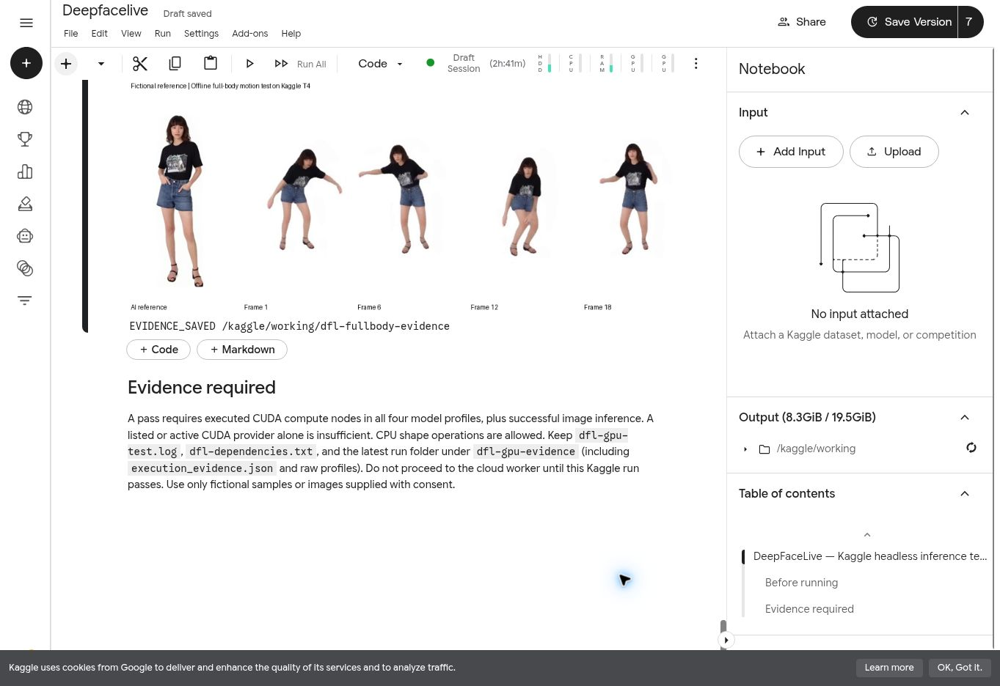
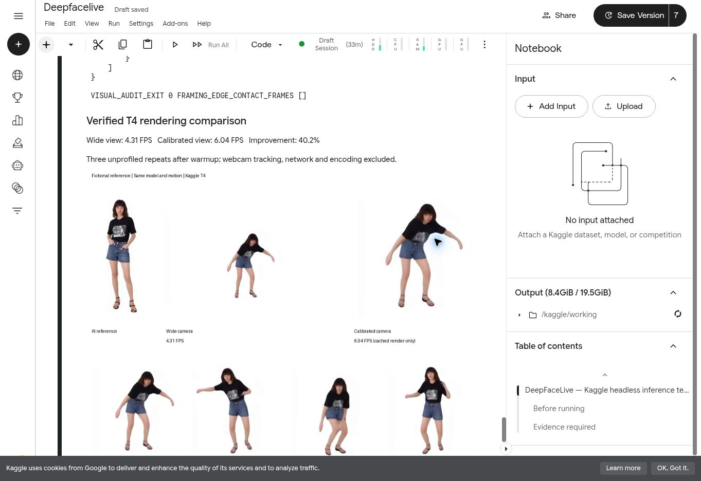
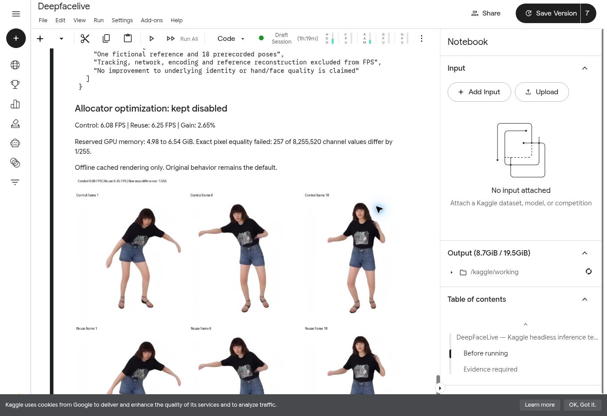

# Full-body avatar feasibility audit

Date: 2026-11-06
Project: johnlilda2-ui/DeepFaceLive
Development branch: experiment/cloud-headless-webrtc
Scope: upstream audit followed by isolated Kaggle runtime and offline single-frame experiments. The existing application/face worker was not changed. See the executed test record below; runtime readiness does not imply successful full-body rendering.

## User requirement

A realistic target's complete face, hair, body and clothing should move with the user's webcam motion, including speech-related facial movement, and return to Windows OBS. A mostly static portrait or face-only swap does not satisfy this requirement. Use fictional examples or consented references.

## Decision

Offline single-frame and three-second rendering feasibility confirmed for the published LHMPP-700M model on Kaggle T4 with the isolated compatibility adapter and settings recorded below. NO-GO for promising or integrating live full-body video yet. No paid GPU, card, subscription or hosting was started for this audit.

## Audited upstream and checkpoints

- Code: https://github.com/aigc3d/LHM-plusplus
- Audited code commit: 906b5d9fb967ab42efb92f6fa55bf22cac86b653
- Published model: https://huggingface.co/3DAIGC/LHMPP-700M
- Model revision: fc9f73664b9bfcc457e96210ddc06fe7caf0d559
- Public metadata returned HTTP 200, gated=false; files include config.json and model.safetensors.
- Retrieved config.json. An actual byte-range request for model.safetensors returned HTTP 206, bytes 0-7/4527981124; safetensors header length 163696. This initially verified file access only; the subsequent executed test below verified complete downloads and inference.
- Public prior-assets metadata: https://huggingface.co/3DAIGC/LHMPP-Prior
- Prior revision: b683c8f68bede4f318b0bb539730b8e6711d30a0; metadata HTTP 200, gated=false. Selected prior assets were subsequently downloaded and executed in the isolated experiment below.
- Anonymous Hugging Face metadata requests for LHMPP-700M-PixelShuffle, LHMPP-700M-SMPLX-FREE and LHMPPS-700M returned HTTP 401. This does not distinguish unpublished/private repositories from access restrictions. Upstream also explicitly marks PixelShuffle hub weights as pending. ModelScope access was not verified; do not assume those variants are obtainable.
- The published LHMPP-700M is not in upstream GS_RENDER_SUPPORTED_MODEL_NAMES. Do not promise the newer plain-Gaussian export/rendering path for this checkpoint.

## Software and T4 compatibility

Upstream INSTALL.md specifies Linux, Python 3.10, PyTorch 2.3.0 and CUDA 12.1. requirements.txt includes older compiled dependencies (pointops, spconv, torch_scatter, PyTorch3D, Gaussian rasterizers, gsplat, xformers). Kaggle's current Python 3.13 host cannot simply use these pinned Python 3.10 wheels. A separate Python 3.10 environment is needed; do not replace the working face-swap CUDA environment or Kaggle host packages.

The retrieved checkpoint config uses DINOv2, not Sapiens, for its image encoder. Optional Sapiens code uses BF16 but is not selected by this checkpoint; do not describe it as a confirmed blocker for LHMPP-700M. The point-transformer config enables FlashAttention, but core/models/encoders/sonata/model.py contains a non-FlashAttention fallback when the package is absent. The later executed test found that the dense fallback ran out of GPU memory. The opt-in CUTLASS adapter below preserves its attention math without allocating the dense attention matrix. The upstream 8 GB memory and sub-second reconstruction claims are not measurements of our T4, live motion tracking, speech animation or complete streaming latency.

## Motion and face tracking gaps

The app renders prepared motion sequences. A reference-image pose estimator exists in engine/pose_estimation/pose_estimator.py, but this is not an end-to-end live webcam streaming integration. The offline helper predict_motion_seqs_from_images invokes thirdparty/multi-hmr; .gitmodules points that submodule to an internal upstream GitLab host. Do not attempt private access or assume recursive cloning produces a runnable tracker. The supplied public pose-estimation code needs separate evaluation as a possible alternative.

SMPL-X/FLAME motion parameters include body, hands, jaw and expression. Their presence in the renderer is not proof of live lip tracking, accurate identity, temporal stability or correct synchronization. A compatible live tracker and expression retargeting path remain separate tasks.

## Licensing

Upstream source code LICENSE is Apache-2.0. LICENSE_WEIGHT is Creative Commons Attribution-NonCommercial 4.0; do not call the entire pipeline unrestricted for commercial use. LICENSE_NVIDIA contains a research/evaluation noncommercial use limitation for covered components. SMPL-X, FLAME, prior assets and other dependencies require their own provenance/license checks. Personal noncommercial evaluation is the proposed scope, not a cleared commercial deployment.

Official references:
- https://github.com/aigc3d/LHM-plusplus/blob/main/LICENSE_WEIGHT
- https://github.com/aigc3d/LHM-plusplus/blob/main/LICENSE_NVIDIA
- https://github.com/aigc3d/LHM-plusplus/blob/main/INSTALL.md
- https://github.com/aigc3d/LHM-plusplus/blob/main/core/utils/model_card.py

## Bounded experiment acceptance plan

1. Check storage, available CUDA compiler and feasibility of an isolated Python 3.10 environment on Kaggle. Review only the selected checkpoint's required assets rather than running download_all.py.
2. Pin code, checkpoint revisions and dependencies. Review downloaded custom-extension sources before building. Record full-file checksums if weights are downloaded.
3. Use a fictional/consented full-body reference and a supplied prerecorded pose sequence. First render a single frame, then a roughly 3-second low-resolution sequence, with explicit timeout and memory limits. Failures are results; do not silently fall back to CPU or claim GPU success from provider availability.
4. Record actual GPU execution, peak memory, setup time, reconstruction time, rendering FPS and a visibly reviewed output. Judge target likeness, clothing, body proportions, hands and temporal artifacts.
5. Proceed to a live tracker only if rendering quality and speed justify it. Benchmark tracking, expression retargeting and transport together before integrating with the existing WebRTC/OBS path.

Live full-body streaming, exact resemblance and speech synchronization remain unverified. The offline rendering measurements below are preliminary profiled results.


## Executed Kaggle experiment — 2026-11-06

Result: PASS for isolated GPU runtime, single-frame neural rendering, and a short offline motion clip. This is not a live webcam worker or a replacement for the working face processor.

### Environment and isolation

- Kaggle exposed two Tesla T4 GPUs, each 15,360 MiB, compute capability 7.5; only one was used by the experiment. Driver: 580.178.04.
- Host Python was 3.13.15. Installed managed Python 3.10.21 and created an isolated experimental environment at `/tmp/dfl-fullbody-env`.
- PyTorch 2.3.0+cu121, torchvision 0.18.0, xformers 0.0.26.post1. Kaggle's available CUDA compiler was 12.8.93; the reviewed extensions compiled successfully for `TORCH_CUDA_ARCH_LIST=7.5`, `MAX_JOBS=2`.
- Keep `LD_LIBRARY_PATH=/usr/local/nvidia/lib64` for Kaggle's driver; removing this path caused a false "no NVIDIA driver" failure. The experimental wheel packages supply their CUDA runtime libraries.
- The working filesystem initially had only 11.47 GiB free. The separate temporary filesystem had about 966 GiB free, so experimental packages, caches and assets were placed there. Temporary assets will need restoring after a Kaggle session restart.
- Existing `/kaggle/working/dfl-cuda12-env`, desktop code and headless face processor were not modified.
- No paid GPU, RunPod instance, paid plan or card was started.

Base requirements installed after supplying chumpy's undeclared pip build dependency and using `--no-build-isolation-package chumpy`. Additional dependencies:

- pointops from the pinned upstream checkout: compiled successfully.
- spconv-cu121 2.3.8, torch-scatter 2.1.2+pt23cu121, PyTorch3D 0.7.6 from the official matching wheel indexes.
- PyTorch3D Python dependencies: iopath 0.1.10 and fvcore 0.1.5.post20221221.
- diff-gaussian-rasterization commit `8829d14f814fccdaf840b7b0f3021a616583c0a1`; GLM submodule `5c46b9c07008ae65cb81ab79cd677ecc1934b903`.
- simple-knn commit `60f461f4a56b7967e5d8045bf92f8c33f36976d0`.
- gsplat 1.4.0+pt23cu121 from the official wheel index.

The versioned runtime probe passed every required import and recorded actual T4 CUDA matrix-multiplication kernels, including `volta_sgemm_32x32_sliced1x4_nn`. Runtime readiness alone was not used to claim model success.

### Asset provenance and compatibility fixes

Downloaded 43 selected prior/model files, 8,663,440,450 bytes in total, to `/tmp/dfl-fullbody-assets`. Checked expected file sizes, computed SHA-256 digests, and compared upstream LFS SHA-256 values where supplied. Retained `asset-manifest.json`. Model/prior revisions are pinned above; unused gaga tracking assets and the large FLAME texture were excluded.

The public prepared-motion bundle came from `3DAIGC/LHMPP-Assets`, revision `c50158bda6b0f2fafec0d81ecdfaaf0430c44d60`. Its 307,312,640-byte tar matched upstream SHA-256 `e2612a18c0def13cf1834951155ac8d9c28529a9bd1ac6906fe1462160c4c8bc`; extracted with Python's data safety filter.

Failures were retained before applying fixes:

1. Strict checkpoint loading found absent `id_face_net` and inherited `neural_renderer.transformer_block` weights. Audited code shows the former is for training identity loss, while this exact `PatchDPT4DecoderOnly.predict_rgbs` uses patchify/chunk/dense_predictor and never executes the inherited transformer blocks. The probe disables only that training loss net and removes only this unused branch, then requires strict loading of all remaining weights. It rejects other decoder types or checkpoints containing those transformer weights.
2. Upstream overrides `train()` without returning self, so `model.eval().to('cuda')` failed. Calls are now separate.
3. Actual neural inference reached serialized attention and failed allocating an additional 6.00 GiB on the dense non-FlashAttention path.
4. Added an opt-in, inference-only xFormers CUTLASS adapter for the exact audited serialized-attention class. It preserves grouping, order, scale and learned weights; rejects unsupported attention settings; checks its result against the dense attention calculation on the actual GPU before applying it. The measured maximum absolute error was `3.5762786865234375e-07`. Adapted 28 modules. No FlashAttention-2 package was installed.

### Actual rendering evidence

Reference: upstream AI-generated `assets/example_aigc_images/055330c0d988_000.jpg`, padded to 504×840. Estimated its own SMPL-X body shape with the supplied pose estimator. No user/private identity image was uploaded for this experiment.

Motion: prepared `BasketBall_I` SMPL-X frames 00014 through 00099, every fifth frame. The source video was verified as 30 FPS. Eighteen frames at 6 FPS produce a three-second sample. This is supplied prerecorded motion, not user webcam tracking.

| Check | Observed result |
| --- | --- |
| Single frame | PASS, 742×420 RGB, visibly nonblank |
| Three-second sequence | PASS, 18 decoded frames |
| Encoded format | H.264, 742×420, 6/1 FPS, duration 3.000000 seconds |
| Inference weights | Strict load passed; all model parameters on CUDA |
| Sequence GPU evidence | 21,279 CUDA compute-kernel events, excluding memcpy/memset |
| Reference reconstruction | 6.2609 seconds |
| Rendering 18 frames after reconstruction | 4.8020 seconds |
| Profiled render throughput | 3.7485 FPS, excluding reconstruction |
| Total profiled inference context | 21.6253 seconds, includes profiler overhead |
| Peak allocated GPU memory | 5,819,250,688 bytes, about 5.42 GiB |
| Peak reserved GPU memory | 7,025,459,200 bytes, about 6.54 GiB |
| First/last frame mean absolute pixel difference | 6.2532 on 0–255 scale |

Timing is from one short profiled run, not an unprofiled steady-state benchmark or an end-to-end latency measurement. Output playback FPS is not measured generation FPS. Model/reference setup took additional time outside the profiled inference context.

Visually reviewed the generated frame and consistent crops of frames 1, 6, 12 and 18 alongside the fictional reference. Body poses change; black graphic shirt, denim shorts, dark hair and sandals remain recognizable. Face/hand details are coarse, limbs can deform, and the wide driving camera leaves the subject small. This is a feasibility pass, not proof of exact likeness or production quality.



### Reproduction and next gate

Scripts on the existing development branch:

- `scripts/lhmpp_runtime_probe.py`: import checks and actual CUDA execution report; explicitly does not claim model inference.
- `scripts/lhmpp_single_frame_probe.py`: strict model loading, reference shape estimation, one frame or a bounded 18-frame clip, timeout supplied by caller, compute-kernel trace and timing reports.
- `scripts/lhmpp_t4_attention.py`: opt-in numerical-checked memory-efficient attention adapter; separate from desktop/face-worker code.

After preparing the isolated runtime and pinned assets, run from the upstream checkout:

```bash
LD_LIBRARY_PATH=/usr/local/nvidia/lib64 \
TORCH_HOME=/tmp/dfl-fullbody-torch-cache \
/tmp/dfl-fullbody-env/bin/python /path/to/DeepFaceLive/scripts/lhmpp_single_frame_probe.py \
  --runtime-root /kaggle/working/dfl-fullbody-runtime \
  --model-dir /tmp/dfl-fullbody-assets/model \
  --reference /kaggle/working/dfl-fullbody-runtime/assets/example_aigc_images/055330c0d988_000.jpg \
  --pose-json /tmp/dfl-fullbody-motion/motion_video/BasketBall_I/smplx_params/00014.json \
  --output-dir /kaggle/working/dfl-fullbody-evidence/new-run \
  --t4-memory-efficient-attention --frames 18 --motion-stride 5 --fps 6
```

Keep `lhmpp_t4_attention.py` next to the probe. The upstream checkout's `pretrained_models` points to `/tmp/dfl-fullbody-assets/prior`. The Kaggle caller imposed a 240-second subprocess timeout per inference attempt.

Actual outputs in the running Kaggle session:

- `/kaggle/working/dfl-fullbody-evidence/runtime-probe.json`
- `/kaggle/working/dfl-fullbody-evidence/asset-manifest.json`
- `/kaggle/working/dfl-fullbody-evidence/experimental-requirements.txt`
- `/kaggle/working/dfl-fullbody-evidence/motion-3seconds/report.json`
- `/kaggle/working/dfl-fullbody-evidence/motion-3seconds/cuda-trace.json`
- `/kaggle/working/dfl-fullbody-evidence/motion-3seconds/motion.mp4`
- `/kaggle/working/dfl-fullbody-evidence/motion-3seconds/comparison.png`
- `/kaggle/working/dfl-fullbody-evidence/encoded-clip-audit.json`

The framing and unprofiled benchmark gate is completed below. Next gate: improve measured model rendering speed and assess quality before integrating a public live pose/expression tracker and retargeting. Live webcam control, lip synchronization, temporal quality across long sessions, WebRTC avatar streaming and OBS output have not been implemented or verified by this test. The working face-swap transport remains separate.


## Framing and fair cached-rendering benchmark — 2026-11-06

Completed on Kaggle's free Tesla T4, using the same fictional reference, pinned model and 18 prerecorded poses as the preceding test. No paid resources were started. Probe source: `e8aa4c177c9ef9759b8a68b589e762c2a7a85b30`.

| Measurement | Wide camera | Calibrated camera |
| --- | ---: | ---: |
| Output pixels | 742×420 | 364×420 |
| Unprofiled repeat FPS | 4.302, 4.325, 4.307 | 6.046, 6.039, 6.027 |
| Median cached rendering FPS | 4.307 | 6.039 |
| CUDA compute-kernel events in separate verification | 21,279 | 21,272 |
| Reference reconstruction seconds, excluded from benchmark | 7.366 | 6.416 |
| Repeated output mean absolute difference from verified run | 0.0 | 0.0 |

The calibrated camera improved measured throughput by **40.23%**. Both conditions use one unprofiled warmup sequence followed by three 18-frame repeats with CUDA synchronization. Wall time includes CPU processing and readback; reference reconstruction, encoding, network and live pose estimation are excluded. Prior profiled throughput is not a fair baseline for this comparison. Peak GPU allocated/reserved memory in the initial verification runs was 5,819,250,688 / 7,025,459,200 bytes; this is not a separately measured benchmark peak.

Both H.264 clips decoded 18 frames at 6/1 FPS with duration 3.000000 seconds. Playback FPS and generation FPS are separate measurements.

### Camera audit and fixes

Added pure-math camera transforms and five passing geometry tests. A uniform crop scale plus horizontal padding preserves proportions when rounding the output width to the model's 14-pixel patch size. Intrinsics and pose parameters are transformed together; original camera consistency and unsupported skew are checked.

The upstream no-mask renderer infers image size from twice the principal point, which is incorrect for an off-center crop. The probe now supplies an explicit canvas through the audited upstream size-carrier branch and checks the rendered dimensions. These arrays are not semantic segmentation masks.

The normalized crop is [0.25326145552560647, 0.19085714285714284, 0.6456603773584906, 1.0], calculated offline from the prior 18-frame foreground union with 8% padding. This uses future frames and is not a live camera tracker. Thresholded foreground bounds for all 18 calibrated frames stayed inside a three-pixel border. Manual review of the reference/comparison and poses 1, 6, 12 and 18 confirms the figure is larger and the clothing remains recognizable; faces/hands and some limb shapes are still coarse.

### Restart recovery audit

The previous session lost temporary runtimes and assets. Added `scripts/restore_lhmpp_kaggle_runtime.py` to rebuild the isolated experimental environment from the retained pinned freeze and checksum manifest. Fixed an executable-permission problem by placing managed Python in /tmp, reused the retained matching pointops binary, cached compiled extension wheels, streamed large-file checksum validation, restricted manifest repository/path handling, and recreated the missing experimental pretrained-model asset symlink. The first attempted wide run failed on that missing link and remains in the output directory; the successful result is in `wide-retry`.

Recovery regression at source `d9b0d714b7bbc5f74f29161b318977bf31442603` completed with exit 0 in 18.909 seconds, reusing the installed runtime and verified assets. This checks idempotent recovery in the current session; it does not prove every future Kaggle image is compatible.

### Evidence and next gate

- [Benchmark summary](evidence/lhmpp-t4-framing-summary.json) is a transcription of actual executed notebook outputs.
- Raw reports, CUDA traces, clips and recovery log are retained under `/kaggle/working/dfl-fullbody-evidence/framing-benchmark-20261106-080151/`.
- Successful condition directories: `wide-retry/` and `framed/`.
- Comparison and pose strips: `framing-comparison.png`, `framed-motion-poses.png`.
- Syntax validation and five geometry unit tests passed.



Next: investigate bounded rendering optimizations and validate image quality against this baseline before webcam retargeting. Approximately 6 FPS cached rendering is still insufficient evidence for a responsive complete live pipeline. Live lip synchronization, webcam pose/expression tracking, long-session stability, avatar WebRTC transport and OBS output remain unverified. Desktop and existing face-worker files were not changed.


## Allocator reuse experiment — 2026-11-06

**Decision: keep disabled by default.** A bounded free Kaggle T4 test measured only a 2.65% cached-rendering gain while reserving more GPU memory. The exact raw-pixel equality gate failed. This experiment does not improve the underlying face, hand or clothing reconstruction quality and does not establish live performance.

| Seeded measurement | Original allocation behavior | Opt-in allocator reuse |
| --- | ---: | ---: |
| Three repeat FPS | 6.087, 6.084, 6.022 | 6.259, 6.245, 6.236 |
| Median FPS | 6.084 | 6.245 |
| Peak allocated bytes during unprofiled benchmark | 5,220,337,664 | 5,220,413,440 |
| Peak reserved bytes during unprofiled benchmark | 5,345,640,448 | 7,025,459,200 |
| CUDA compute-kernel events in verification run | 21,276 | 21,279 |
| Strict weight loading and GPU inference | PASS | PASS |

Both conditions used the same fictional reference, camera crop, 364×420 output, 18 supplied poses and seed 0. Each had one warmup sequence and three timed repeats with CUDA synchronization. CPU processing and readback are included; reconstruction, encoding, tracking and network are excluded. The initial unseeded attempt had different reconstruction pixels and was not accepted as a controlled quality comparison. Seeding reduced this variability substantially, but it does not promise deterministic CUDA execution.

Across the seeded sequences, 257 of 8,255,520 channel values differed by one intensity level out of 255 (maximum error 1, mean error 0.0000311307). This failed the existing exact-equality gate; the gate was not relaxed. The tiny residual is consistent with floating-point rounding/quantization, but its cause was not isolated. Manual comparison of poses 1, 6 and 18 showed no visible structural change. Both H.264 files decoded 18 frames at 6/1 FPS for 3.000000 seconds. Image quality remains limited by the original reconstruction.

### Changes and audit

- `scripts/lhmpp_render_allocator.py` clones only the pinned model's animation function with a local CUDA proxy. It suppresses the audited per-frame cache release without modifying the global torch.cuda object, other model functions, or upstream files.
- `scripts/lhmpp_single_frame_probe.py --reuse-render-allocator` is opt-in. Default behavior stays unchanged. Probe RNG inputs are seeded for comparisons, raw RGB sequences are saved with pickle disabled, and the unprofiled benchmark reports separate memory peaks.
- `scripts/lhmpp_allocator_comparison.py` checks matching reference/poses/camera/seed, CUDA evidence, strict loading, raw frames and decoded video metadata. An equality failure is saved as `passed: false` with a nonzero exit, alongside a comparison image.
- Three isolation tests passed, including restoration of original behavior after the cloned function raises. Syntax checks passed. The GPU adapter suppressed 90 cache-release calls across verification, warmup and repeats.
- The first comparison-image label incorrectly asserted exact pixels after the gate failed. The audit caught this, the label now shows measured maximum error, and the comparison was rerun successfully with expected rejection exit 1.

Probe source tested: `d4aa580d9519feddf58700764f37307cde049028`. Final comparison source tested: `db0449cbeb7faf5076cd2b02dd821b7167d93d8b`.

Reproduce using the preceding probe command and identical camera arguments, with `--benchmark-repeats 3` for both runs and `--reuse-render-allocator` only for the second. Compare the two distinct output directories:

```bash
/tmp/dfl-fullbody-env/bin/python scripts/lhmpp_allocator_comparison.py \
  --control-dir /path/to/control --reuse-dir /path/to/reuse \
  --output-dir /path/to/audit
```

Exit 1 is expected for the recorded experiment because exact pixel equality failed; it must not be reported as a successful promotion.

Evidence: [transcribed summary](evidence/lhmpp-t4-allocator-summary.json). Full reports, raw frames, traces, clips, original rejection log and preserved comparison are under `/kaggle/working/dfl-fullbody-evidence/allocator-benchmark-20261106-085450/`, with the controlled rerun in `seeded/`.



The normal renderer remains the baseline. The next bounded speed investigation should profile the neural decoder and test a precision change against explicit image-quality criteria before connecting webcam pose estimation. Live lips, webcam retargeting, WebRTC avatar transport, long-session stability and OBS output are still pending. No paid compute was started. All changes are confined to experimental scripts and evidence; master, the desktop app and the existing face worker remain unchanged.
